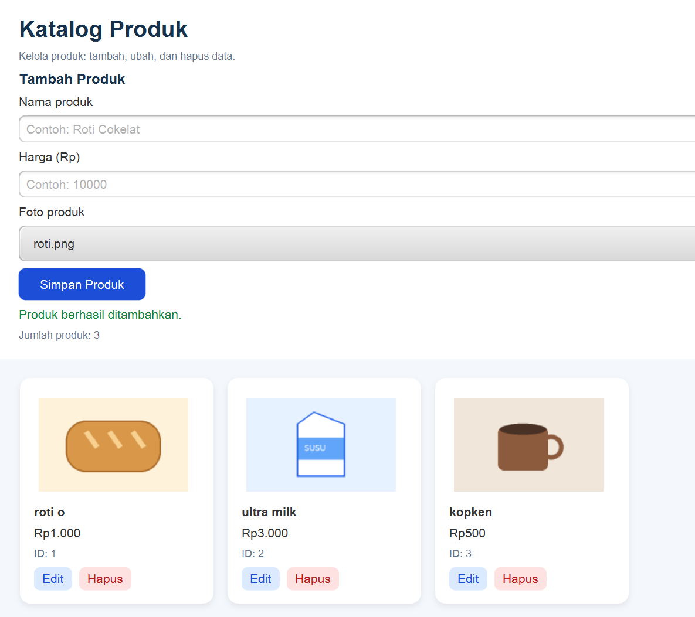

# Katalog Produk UPI Store

Aplikasi desktop katalog produk sederhana menggunakan **JavaFX**, **FXML**, **CSS**, dan **SQLite**. Proyek ini memiliki fitur CRUD: Create (tambah), Read (lihat), Update (ubah), dan Delete (hapus) produk.

## Fitur

- Menambahkan produk dengan nama, harga, dan pilihan foto.
- Menampilkan seluruh produk dari database SQLite.
- Mengubah data produk melalui tombol **Edit** pada kartu produk. Data terpilih akan dimasukkan kembali ke form.
- Menghapus produk melalui tombol **Hapus**, disertai dialog konfirmasi.
- Menampilkan jumlah produk dan pesan hasil operasi.
- Validasi nama, harga positif, dan foto produk.
- Database `data/katalog.db` dibuat otomatis ketika aplikasi pertama kali dijalankan.

## Teknologi dan prasyarat

- JDK 17 atau lebih baru.
- Apache Maven 3.8 atau lebih baru.
- JavaFX 21 (dependency diunduh otomatis oleh Maven).
- SQLite JDBC (dependency diunduh otomatis oleh Maven).
- Koneksi internet saat pertama kali menjalankan Maven untuk mengunduh dependency.

## Cara menjalankan aplikasi

1. Pastikan JDK dan Maven sudah terpasang. Periksa melalui terminal:

   ```bash
   java -version
   mvn -version
   ```

2. Ekstrak repository, lalu buka terminal pada folder yang berisi `pom.xml`.

3. Jalankan aplikasi:

   ```bash
   mvn clean javafx:run
   ```

4. Jendela **Katalog Produk** akan terbuka. Database SQLite dibuat otomatis di folder `data/katalog.db`.

> Pada Windows, perintah yang sama dapat dijalankan melalui PowerShell atau Command Prompt selama `mvn` sudah masuk ke PATH.

## Cara menggunakan

### Menambah produk

1. Isi **Nama produk**.
2. Isi **Harga (Rp)** menggunakan angka bulat, misalnya `12000`.
3. Pilih foto produk.
4. Klik **Simpan Produk**. Produk baru akan muncul pada area katalog.

### Mengubah produk

1. Klik **Edit** pada kartu produk yang ingin diubah.
2. Form di bagian atas akan terisi dengan data produk tersebut.
3. Ubah nama, harga, atau foto.
4. Klik **Simpan Perubahan**. Klik **Batal Edit** jika tidak jadi mengubah data.

### Menghapus produk

1. Klik **Hapus** pada kartu produk.
2. Periksa nama produk pada dialog konfirmasi.
3. Pilih **OK** untuk menghapus atau **Cancel** untuk membatalkan.

## Struktur proyek

```text
KatalogProduk/
├── data/                         # Database dibuat otomatis saat aplikasi berjalan
├── screenshots/
│   └── katalog-preview.png       # Preview tampilan antarmuka
├── src/
│   └── main/
│       ├── java/
│       │   ├── controller/
│       │   │   └── KatalogController.java
│       │   ├── data/
│       │   │   └── ProdukRepository.java
│       │   ├── db/
│       │   │   └── Database.java
│       │   ├── main/
│       │   │   └── MainApp.java
│       │   └── model/
│       │       └── Produk.java
│       └── resources/
│           ├── image/
│           └── view/
│               ├── katalog.fxml
│               └── styles/app.css
├── .gitignore
├── pom.xml
└── README.md
```

## Screenshot

Berikut preview desain antarmuka katalog setelah fitur Edit dan Hapus ditambahkan:




## Catatan database

File database berada di `data/katalog.db` dan tidak disertakan ke GitHub karena masuk `.gitignore`. Data produk tersimpan secara lokal pada komputer tempat aplikasi dijalankan. Menghapus file database akan menghapus data katalog lokal tersebut.
